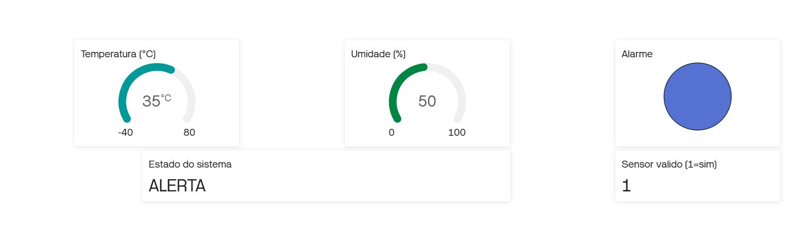
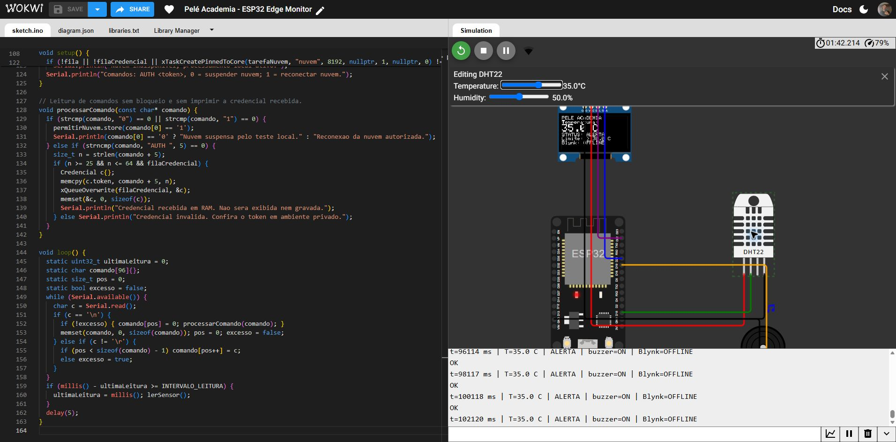

# Pelé Academia — Sprint 4 de Edge Computing

Protótipo de monitoramento ambiental com **ESP32, DHT22, OLED SSD1306 I2C, buzzer e Blynk**. O ESP32 lê o sensor a cada 2 segundos, decide localmente e informa o estado à nuvem.

## Acesso à entrega

- **Repositório público:** https://github.com/caiovfaria/Sprint4-Edge
- **Simulação Wokwi:** https://wokwi.com/projects/479357102690024449
- **Dispositivo e painel Blynk:** https://blynk.cloud/dashboard/359336/global/devices/126785/organization/359336/devices/1091498/dashboard
- **Template Blynk:** https://blynk.cloud/dashboard/359336/templates/787381/dashboard
- [Descrição da solução e operações de borda e nuvem](RELATORIO_SPRINT4.md)
- [Resultados e capturas dos testes](TESTES.md)
- [Configuração do Blynk](BLYNK.md)

**Acesso do professor ao Blynk:** os links do Blynk exigem autenticação e permissão na conta/organização. O repositório, o Wokwi e as capturas são públicos. Publicar o link não concede acesso ao painel. Para cumprir integralmente esse requisito, o professor deve receber acesso de visualização pela plataforma; não compartilhe o token nem a senha da conta.

## Evidências principais

A integração, a operação durante a interrupção e a reconexão foram testadas. Consulte TESTES.md para a sequência completa. A simulação foi parada após os testes; é necessário iniciá-la e informar o token para voltar a transmitir.

## Regra e processamento na borda

| Temperatura lida | Estado | Buzzer |
|---|---|---|
| Menor ou igual a 30 °C | NORMAL | Desligado |
| Acima de 30 °C | ALERTA | 2000 Hz |
| Leitura inválida | ERRO SENSOR | Acionado |

O limite de 30 °C é uma regra didática do trabalho. A comparação, o acionamento do buzzer e a atualização da IHM são feitos no ESP32. Uma tarefa FreeRTOS separada cuida do Wi-Fi e do Blynk. Durante uma indisponibilidade da nuvem, o sistema local continua operando; ao reconectar, envia o valor atual. Não há armazenamento de histórico offline.

## Circuito

| Componente | Ligação ao ESP32 |
|---|---|
| DHT22 VCC / GND | 3V3 / GND |
| DHT22 DATA | GPIO 15 |
| DHT22 NC | Sem ligação |
| OLED VCC / GND | 3V3 / GND |
| OLED SDA / SCL | GPIO 21 / GPIO 22 |
| Buzzer positivo / negativo | GPIO 19 / GND |

OLED: 128 × 64, endereço I2C 0x3C. O buzzer simulado está no volume mínimo 0.01. Em montagem física com DHT22 avulso, use pull-up de aproximadamente 10 kΩ entre DATA e 3V3; alguns módulos já o incluem. Não foi montado protótipo físico nesta entrega.

## Como executar

1. Abra o link Wokwi e pressione o botão verde de iniciar. Aguarde compilação e a primeira leitura.
2. Clique no DHT22. Teste 25 °C, 35 °C e o limite de 30 °C. Aguarde a próxima leitura a cada mudança.
3. Para acompanhar remotamente, abra o dispositivo Blynk na conta autorizada.
4. Copie seu Auth Token do Blynk. No campo de entrada do Monitor Serial, envie **AUTH**, um espaço e o token, e pressione Enter. Não cole o token no editor do código.
5. Aguarde o OLED mostrar Blynk ONLINE e confira o valor no painel do dispositivo. O painel do Template usa exemplos; verifique o painel do dispositivo para ver leituras reais.
6. Envie **0** e Enter para desconectar Blynk e Wi-Fi e suspender reconexões. Alterne a temperatura e demonstre a decisão local com Blynk OFFLINE.
7. Envie **1** e Enter para reconectar. Confirme o retorno a ONLINE e o envio da temperatura atual.
8. Pare a simulação ao terminar. Ao reiniciar, informe o token novamente.

O token fica somente na RAM da sessão em execução e não é gravado no sketch nem impresso pelo firmware. O código público contém o placeholder SEU_AUTH_TOKEN. O Template ID é um identificador público, não uma credencial. Use o campo de entrada somente em sessão privada e evite mostrar a digitação em capturas. O comando AUTH é destinado à simulação didática com acesso local confiável.

## Arquivos e bibliotecas

- sketch.ino — leitura, decisão, IHM, buzzer, conexão e comandos de teste.
- diagram.json — componentes e ligações no Wokwi.
- libraries.txt — Blynk, DHT sensor library for ESPx, Adafruit GFX Library e Adafruit SSD1306.
- RELATORIO_SPRINT4.md — explicação escrita pedida no enunciado.
- TESTES.md e evidencias/ — resultados e capturas.
- BLYNK.md — mapeamento do painel e observações de acesso.

Para reconstruir, crie um projeto ESP32 no Wokwi e copie sketch.ino, diagram.json e libraries.txt. A rede simulada é Wokwi-GUEST, sem senha, canal 6.

## O que pertence à nuvem

| Pin | Datastream | Tipo | Significado |
|---|---|---|---|
| V0 | Temperatura | Double | -40 a 80 °C |
| V1 | Alarme | Integer | 0 normal, 1 alerta ou falha |
| V2 | Umidade | Double | 0 a 100 % |
| V3 | Estado | String | NORMAL, ALERTA ou ERRO SENSOR |
| V4 | Sensor valido | Integer | 0 leitura inválida, 1 leitura válida |

Durante falha do sensor, V0 e V2 deixam de ser atualizados. Consulte V3 e V4 para identificar a falha. Durante queda de comunicação, valores antigos no painel não são novas leituras. O Blynk não participa da decisão nem aciona o buzzer.

## Formato da entrega

O enunciado da Sprint 4 de Edge Computing e Computer Systems pede código e links no GitHub, capturas da IHM e do Blynk e uma breve descrição das operações na borda e na nuvem. Vídeo não é exigido na seção consultada. A fotografia do protótipo aplica-se quando houver implementação física. A configuração de acesso do professor ao Blynk deve ser concluída antes da avaliação.

## Referências oficiais

- [DHT22 no Wokwi](https://docs.wokwi.com/parts/wokwi-dht22)
- [OLED SSD1306](https://docs.wokwi.com/parts/board-ssd1306)
- [Buzzer](https://docs.wokwi.com/parts/wokwi-buzzer)
- [Monitor Serial](https://docs.wokwi.com/guides/serial-monitor)
- [Conexão Blynk](https://docs.blynk.io/en/blynk-library-firmware-api/connection-management)
- [Acesso aos dashboards Blynk](https://docs.blynk.io/en/blynk.console/dashboards)
