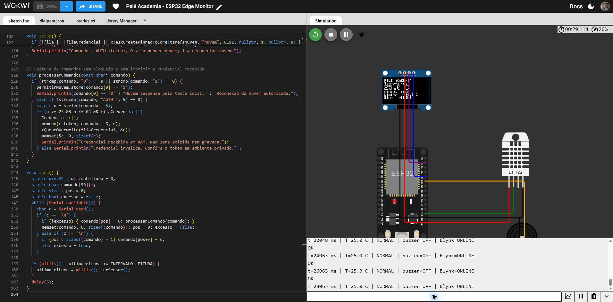
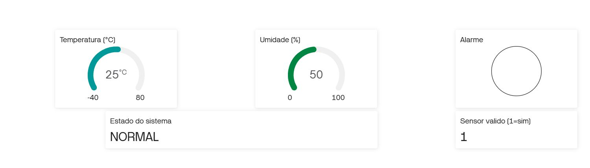
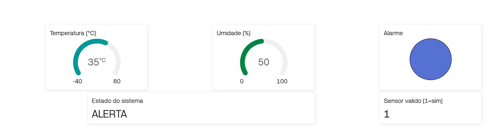
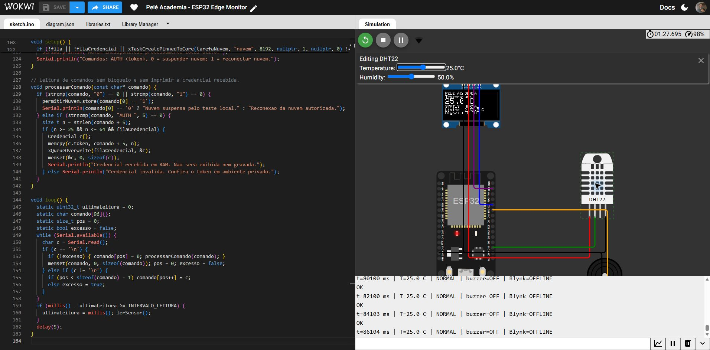
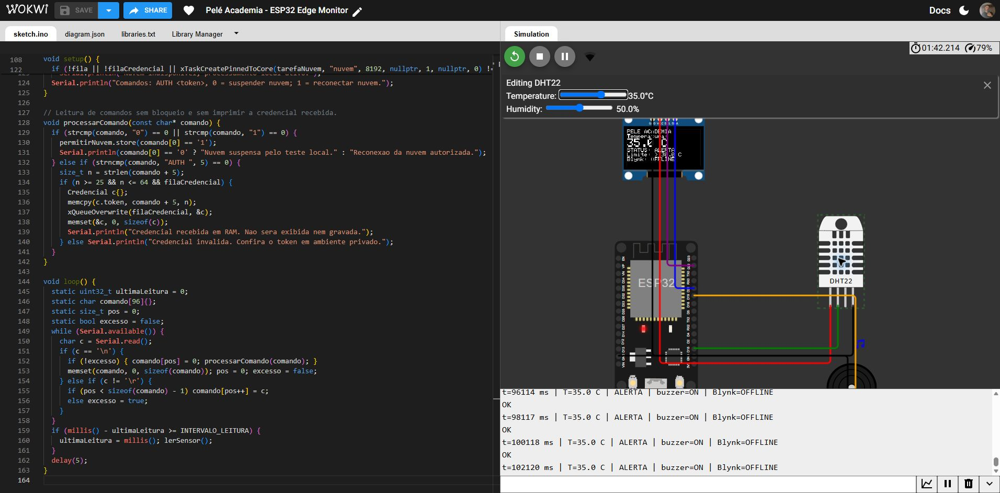
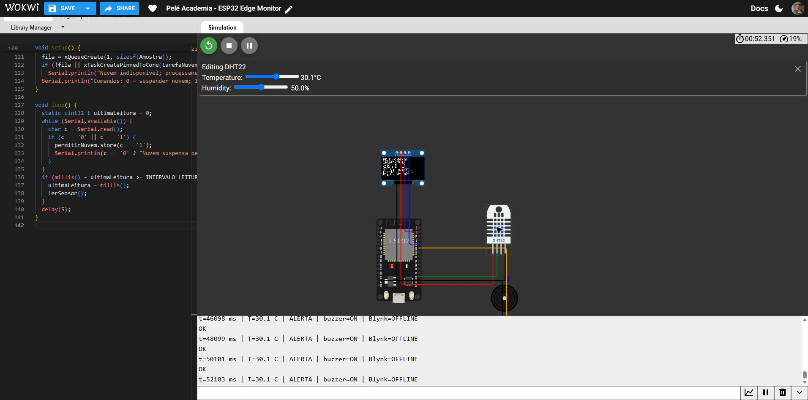

# Testes executados no Wokwi e Blynk

## Versão integrada

ESP32 com DHT22 no GPIO 15, OLED SDA/SCL nos GPIOs 21/22 e buzzer no GPIO 19. Leitura nominal a cada 2 segundos; volume simulado 0.01. Autenticação Blynk recebida pelo Monitor Serial e mantida apenas em RAM. Os testes abaixo foram efetivamente observados na simulação e no painel do dispositivo.

| Etapa | Entrada ou ação | Resultado observado |
|---|---|---|
| Partida sem token | 25 °C | NORMAL, buzzer OFF e leitura local com Blynk OFFLINE |
| Autenticação | Token temporário em RAM | Blynk ONLINE; painel real mostrou 25 °C, umidade 50, NORMAL e validade 1 |
| Alerta conectado | 35 °C | OLED ALERTA, buzzer ON; Blynk mostrou 35 °C e ALERTA |
| Interrupção | Comando 0 e Enter | Wi-Fi/Blynk desconectados, reconexões suspensas |
| Normal sem nuvem | 25 °C | OLED NORMAL, buzzer OFF, Blynk OFFLINE |
| Alerta sem nuvem | 35 °C | OLED ALERTA, buzzer ON, Blynk OFFLINE |
| Recuperação | 25 °C e comando 1 | Blynk voltou a ONLINE; painel real voltou a 25 °C e NORMAL |

Exemplos do Monitor Serial:

- t=14059 ms: 25.0 °C, NORMAL, buzzer OFF, Blynk ONLINE.
- t=52057 ms: 35.0 °C, ALERTA, buzzer ON, Blynk ONLINE.
- t=74094 ms: 25.0 °C, NORMAL, buzzer OFF, Blynk OFFLINE.
- t=88107 ms: 35.0 °C, ALERTA, buzzer ON, Blynk OFFLINE.
- t=114129 ms: 25.0 °C, NORMAL, buzzer OFF, Blynk ONLINE após reconexão.

A reconexão gerou uma mensagem transitória do Wi-Fi enquanto a associação estava em andamento; a comunicação foi restabelecida e a tarefa local continuou lendo durante esse intervalo. A simulação foi parada ao final para evitar som e consumo contínuo da cota Blynk. O painel pode aparecer offline enquanto ela estiver parada.

## Capturas da execução integrada

### IHM local em condição normal com nuvem conectada

### Painel Blynk com leitura real normal

### IHM em alerta com nuvem conectada

### Painel Blynk com leitura real de alerta

### Decisão local em condição normal durante interrupção

### Decisão local em alerta durante interrupção

### Retorno da comunicação

## Testes de fronteira anteriores à integração

Na montagem local já corrigida no GPIO 15, antes da autenticação Blynk, também foram observados 30.0 °C como NORMAL e 30.1 °C como ALERTA. A regra local e o circuito são os mesmos da versão integrada. A primeira tentativa de montagem no GPIO 4 apresentou TIMEOUT; o circuito final foi corrigido e validado no GPIO 15.

O acionamento do buzzer foi confirmado pela sinalização do componente no simulador e pelo Monitor Serial; não foi medida fisicamente a frequência ou a pressão sonora. Não houve montagem física nesta entrega.
